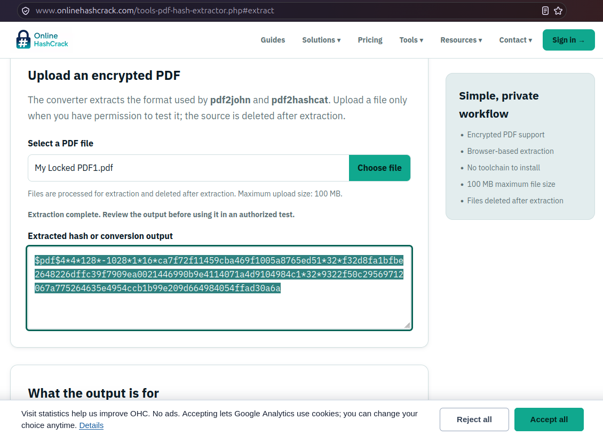
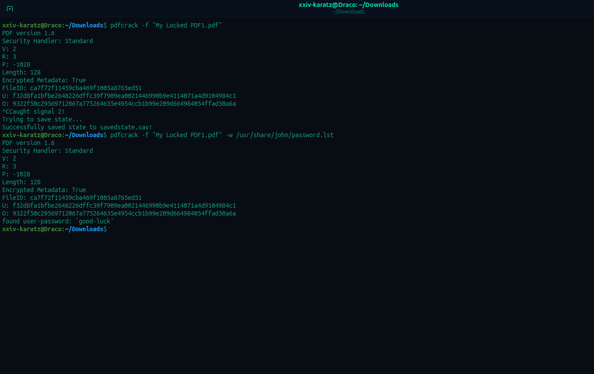
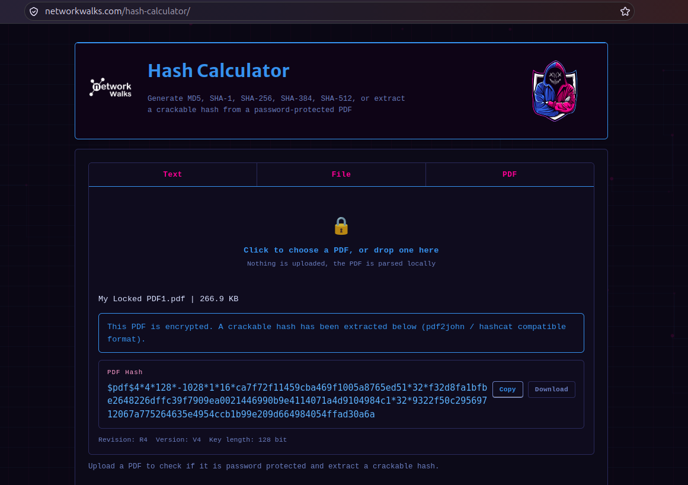
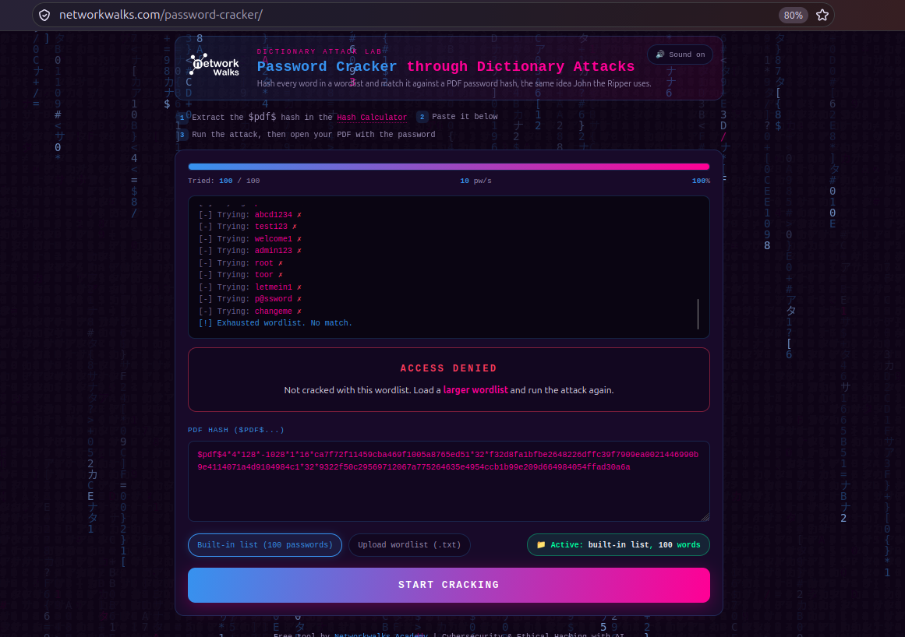
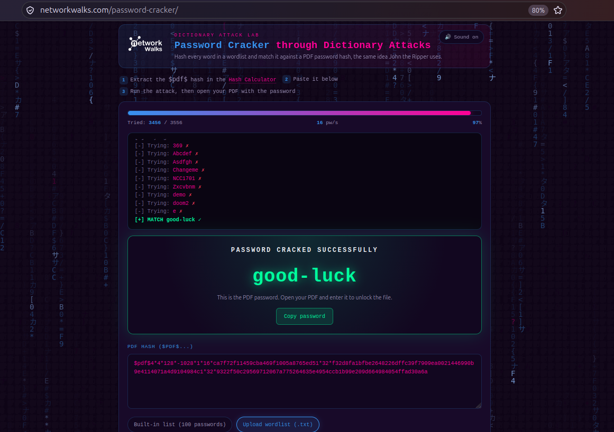

# PASSWORD CRACKING REPORT

## Password Cracking Phase

**W3-PM-FINAL | CYBERSECURITY | NETWORKWALKS**

| Field | Detail |
| --- | --- |
| Pentester Name (Cybersecurity Professional) | Khulekani Mtshali |
| Program/Batch | B084-Networkwalks |
| Date | 23 November 2026 |
| Modules completed | W3-PM1 (Password Cracking with JTR); W3-PM2 (Password Cracking with NetworkWalks Tools) |
| Client/Target | My Locked PDF1.pdf (provided by Networkwalks for the lab) |
| Permission secured from client? | Yes |
| Phases covered | Phase 5: Password Attacks |

## 1. Liability Disclaimer

I have performed these activities only on the file provided by Networkwalks for this lab exercise, which I had explicit permission to test. All these materials are for education and research purpose only. Do not use anything from here to break the law. The instructor, the authors and Networkwalks are not responsible for what you do with this knowledge. Every action you take is your own responsibility. Misuse can lead to criminal charges, heavy fines, loss of your job and a permanent record. In most countries unauthorised access is a crime even when nothing is damaged.

## 2. Introduction

This report covers Week 3 of my Cybersecurity & Ethical Hacking internship at Networkwalks, focused on password cracking. I completed both essential modules: cracking a protected PDF file (My Locked PDF1.pdf) using John the Ripper (W3-PM1) and using Networkwalks' own browser-based Hash Calculator and Password Cracker tools (W3-PM2).

Both modules target the same locked PDF and demonstrate the same underlying concept from two different toolsets: extracting a crackable hash from a password-protected file, then running that hash against a wordlist until a match is found.

W3-PM1 was performed on Ubuntu Linux rather than Windows as described in the lab guide, which required adapting the provided steps to the Linux toolchain. W3-PM2 was performed in a standard web browser, as intended by the lab.

## 3. Tools Used

| Tool | Purpose |
| --- | --- |
| Ubuntu Linux | Operating system used for the JTR-based module |
| John the Ripper (john, core build) | Industry-standard password cracking tool; used to attempt to load the extracted hash |
| pdfcrack | Dedicated PDF password-cracking tool; used in place of John the Ripper jumbo once the core build was found not to support PDF hashes |
| onlinehashcrack.com (PDF Hash Extractor) | Browser tool used to extract the pdf2john/hashcat-compatible hash from the locked PDF |
| Networkwalks Hash Calculator | Browser tool used to extract the same crackable hash format, entirely client-side |
| Networkwalks Password Cracker | Browser tool used to run a dictionary attack against the extracted hash |

## 4. Activities Performed

### 4.1 Password Cracking with JTR (W3-PM1)

I began by installing John the Ripper on Ubuntu via `sudo apt install john`. The Johnny GUI package was not available in the Ubuntu repositories, so I planned to continue using John on the command line instead, which is the standard way of running it on Linux.

The lab guide's Windows workflow relies on `pdf2john.pl` to convert the locked PDF into a crackable hash. I searched my system for this script using `locate` and `find`, and confirmed via `dpkg -L john | grep -i pdf` that it was not present. Checking John's own supported format list (`--format=`) confirmed that Ubuntu's `john` package is the "core" build, which only supports a small set of classic hash types (descrypt, bsdicrypt, md5crypt, bcrypt, LM, AFS, tripcode, crypt) and does not include PDF, ZIP or Office support. That functionality is only available in the "jumbo" build, which is not in Ubuntu's default repositories.

I extracted the hash instead using the browser-based onlinehashcrack.com PDF Hash Extractor, which produces the same pdf2john/hashcat-compatible format:

```
\$pdf\$4*4*128*-1028*1*16*ca7f72f11459cba469f1005a8765ed51*32*f32d8fa1bfbe2648226dffc39f7909ea0021446990b9e4114071a4d9104984c1*32*9322f50c29569712067a775264635e4954ccb1b99e209d664984054ffad30a6a
```

Since John's core build could not load this hash (`No password hashes loaded`), I switched to **pdfcrack**, a dedicated PDF password-recovery tool, installed via `sudo apt install pdfcrack`. An initial brute-force run was interrupted, and I reran it against John's bundled wordlist:

```
pdfcrack -f "My Locked PDF1.pdf" -w /usr/share/john/password.lst
```

This returned a match:

```
found user-password: 'good-luck'
```

I confirmed the result by opening My Locked PDF1.pdf and entering `good-luck`, which successfully unlocked the file and displayed the "Congratulations" flag page.

### 4.2 Password Cracking with Networkwalks Tools (W3-PM2)

For the second module, I downloaded the same My Locked PDF1.pdf and uploaded it to the Networkwalks Hash Calculator (PDF tab), which extracted the identical hash entirely client-side, confirming the PDF is encrypted and producing a pdf2john/hashcat-compatible hash.

I copied the hash into the Networkwalks Password Cracker and first ran it against the tool's built-in 100-password list. This attempt exhausted the wordlist without a match (`ACCESS DENIED - Not cracked with this wordlist`), demonstrating that a small, generic wordlist is not always sufficient even for a weak password.

I then uploaded a larger wordlist (JTR\_default\_password.txt, 3,556 words) and reran the attack. This successfully cracked the hash, returning the same password found in W3-PM1: `good-luck`. I confirmed this by opening the PDF with the recovered password.

## 5. Risk Analysis / Impact

| # | Risk / Finding | Evidence / Observation | Potential Impact | Risk Level |
| --- | --- | --- | --- | --- |
| 1 | Weak, guessable password protecting a sensitive file | Password "good-luck" cracked using a 3,556-word list in under a minute | Files protected with short, dictionary-based passwords can be opened by an attacker with freely available tools and minimal effort | Medium |
| 2 | Password hash recoverable from an encrypted PDF | Crackable hash extracted directly from the file in seconds using free browser tools | Any PDF encrypted with standard password protection can have its hash extracted without needing the password first, enabling offline cracking | Medium |
| 3 | Small built-in wordlists give a false sense of security | The built-in 100-word list failed; a 3,556-word list succeeded | Relying on a short wordlist during testing can understate real-world risk, since attackers use wordlists with millions of entries (e.g. rockyou.txt) | Low |
| 4 | Distribution-packaged security tools may lack full functionality | Ubuntu's `john` core package does not support PDF/ZIP/Office cracking without the jumbo build | Analysts may incorrectly assume a tool is not working, or substitute another tool, without realizing the limitation is the build/distribution rather than the technique | Low |

Risk level key: Critical / Medium / Low

The risks above are observations from a controlled, authorized lab exercise using a file provided for that purpose, not findings against a live production system.

## 6. Recommendations

- Use long, random, non-dictionary passphrases for any file requiring password protection, rather than short, common words or phrases.
- Where possible, pair file-level encryption with additional access controls (e.g. restricted sharing, encrypted storage) rather than relying on password protection alone.
- When testing or auditing password strength, use realistic, large wordlists (e.g. rockyou.txt) rather than small sample lists, to avoid underestimating risk.
- When selecting cracking tools in Linux environments, confirm which hash formats a packaged build actually supports before assuming a tool is broken; install the jumbo/community build or an equivalent dedicated tool (e.g. pdfcrack) where needed.
- Periodically test internally protected documents against common wordlists as part of routine security hygiene, to catch weak passwords before they are exploited externally.

## 7. Conclusion

During Week 3 of my Cybersecurity & Ethical Hacking internship, I completed both essential password-cracking modules, approaching the same target file from two different toolchains.

In W3-PM1, I learned that distribution-packaged security tools can have reduced functionality compared to their full upstream releases, and that recognizing and working around this (in this case, substituting pdfcrack for John the Ripper's missing PDF support) is itself a practical skill. In W3-PM2, I saw directly how wordlist size affects cracking success, with an identical attack failing against a 100-word list and succeeding against a 3,556-word list.

Both modules reinforced the same core lesson: password strength is not just about the password itself, but about matching it against realistic attacker capability. A password that resists a small test wordlist can still fall quickly to a slightly larger one, which is why real-world password policies should assume attackers have access to very large, breach-based wordlists rather than small samples.

These exercises were completed as part of the assigned educational cybersecurity lab, using a file provided specifically for that purpose.

## 8. Evidences Collected

**PM-1 (JTR / pdfcrack, Ubuntu)**

### Hash extracted

The pdf2john/hashcat-compatible hash was obtained from the encrypted PDF using the browser-based PDF hash extractor.



### Password cracked with pdfcrack

After the Ubuntu `john` package rejected the PDF hash because it lacked jumbo-build PDF support, `pdfcrack` successfully matched the password `good-luck` against John's password list.



**PM-2 (Networkwalks Tools)**

### Hash extracted with Networkwalks Hash Calculator

The PDF was processed locally in the browser, and the Networkwalks Hash Calculator extracted the matching PDF hash.



### Built-in wordlist attempt

The attack with the built-in 100-password list exhausted the wordlist and did not find a match.



### Password cracked with the larger wordlist

Using `JTR_default_password.txt` (3,556 words), the Password Cracker matched the hash and recovered `good-luck`.



### PDF successfully unlocked

The recovered password opened the PDF and displayed the Networkwalks congratulations page and captured flag.


